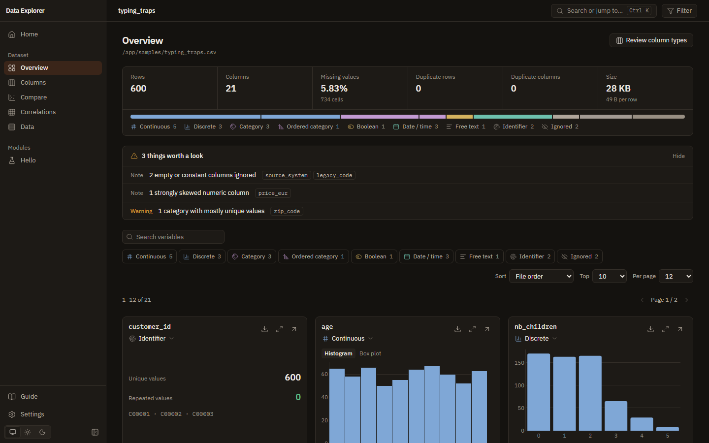
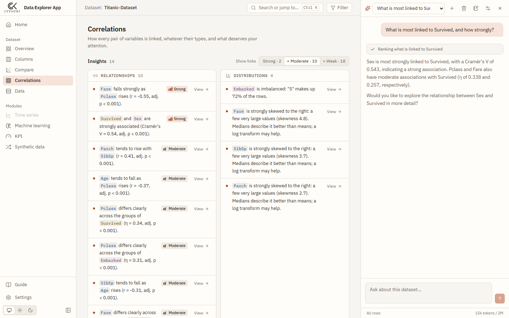
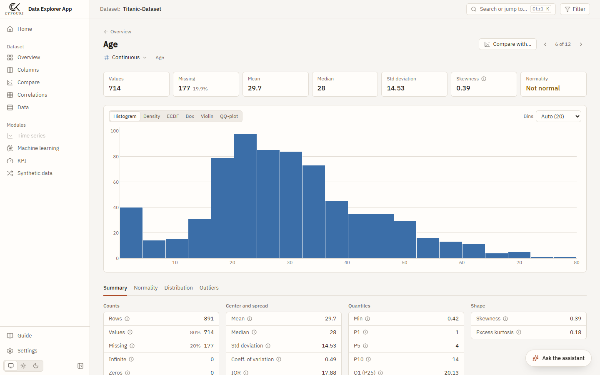
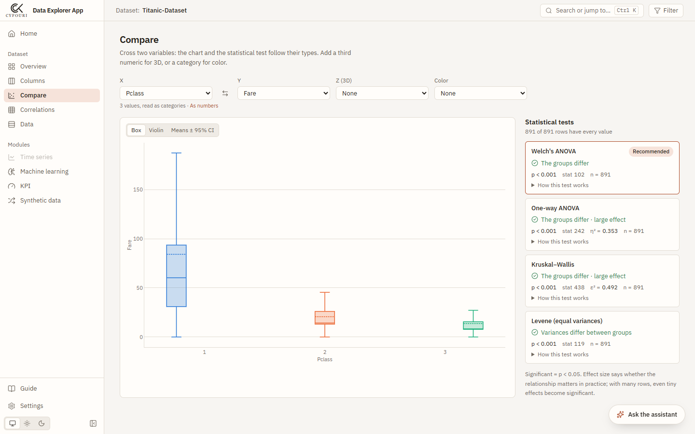
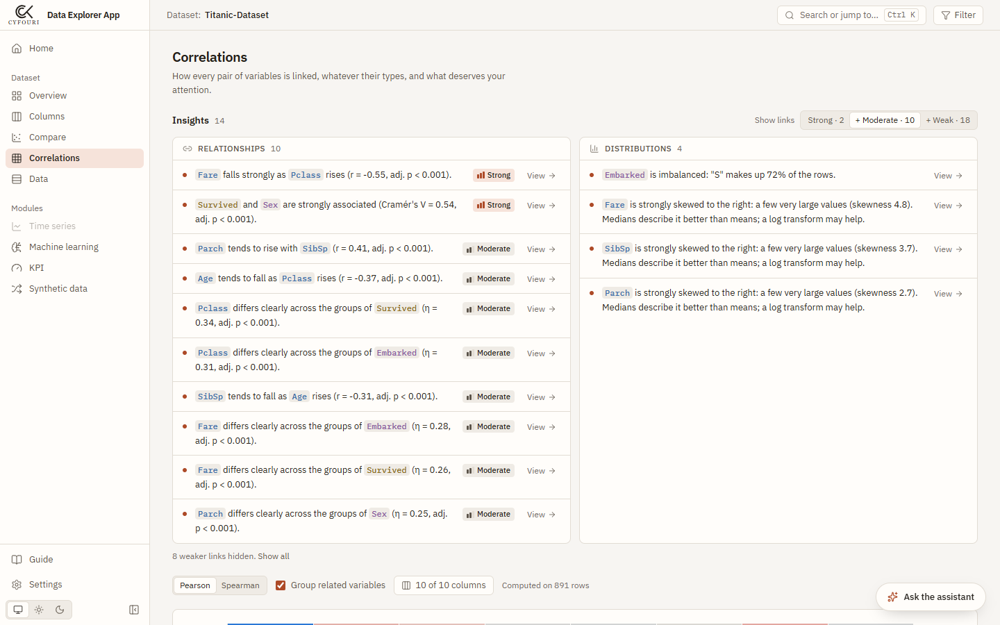
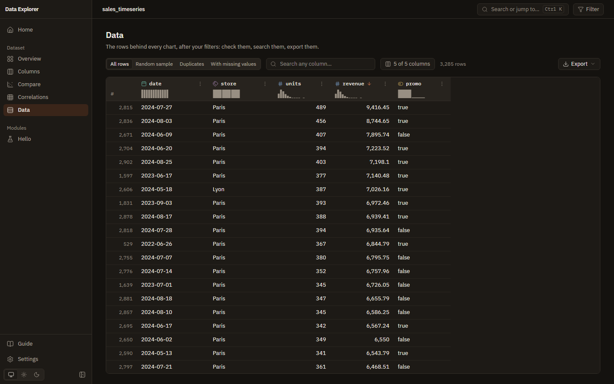
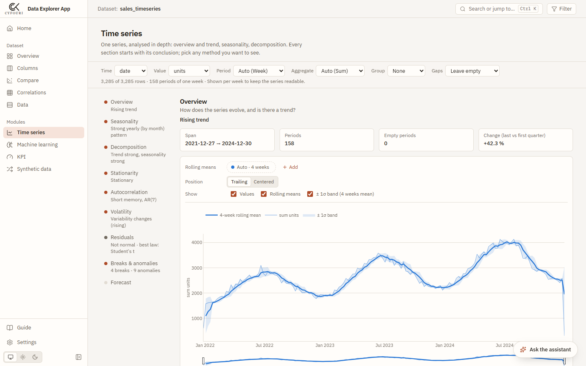
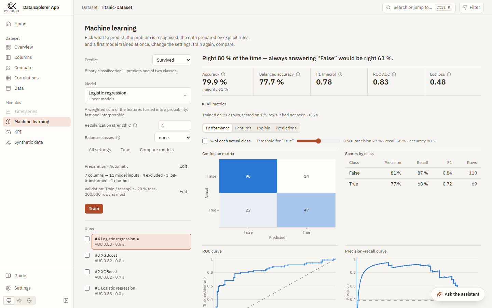
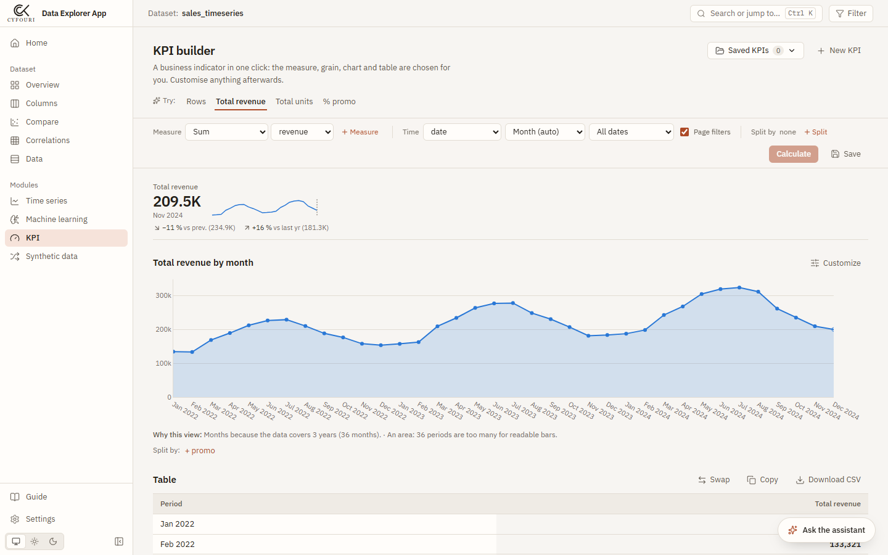
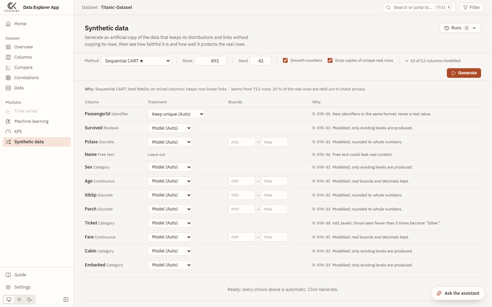

# Data Explorer

[](https://github.com/CyrilKFOURI/data-explorer/actions/workflows/ci.yml)
[](LICENSE)

**The statistical depth of a notebook written by a statistician, without writing code.**
Open a CSV, Parquet or Excel file and get the right chart and the right test for every column, with effect sizes, checked assumptions and results explained in plain words. Then go further: time series, machine learning, KPIs, synthetic data, an HTML report, and an AI assistant that runs all of it for you. Local and offline: your data never leaves your computer.



## Why

Automatic EDA tools (ydata-profiling, sweetviz…) stop at descriptive statistics: few real tests, no check of their conditions, little help to read them. Data Explorer chooses the analysis from the column types, runs the tests a careful statistician would (normality, law fitting, bivariate tests with effect sizes, multiple-testing awareness), and says what the result means — with a second, deeper level of explanation for students.

## Features

**Exploration**
- **Column types** detected and explained — numbers, categories, booleans, dates, identifiers, free text — from a knowledge base of naming patterns and value checks (French decimals, `oui/non`, `21/02/2019`, `5%`, ZIP codes…), and editable.
- **Variable page**: descriptive statistics, normality tests, law fitting ranked by AIC, outlier rules.
- **Compare** two or three variables: the chart and the test follow their types (t / Welch / Mann-Whitney, ANOVA / Kruskal-Wallis, chi-square, correlations), with effect sizes and conditions checked.
- **Correlations** across every pair of types (Pearson, Spearman, Cramér's V, η), clustering, and insights graded by evidence.
- **Data** table for millions of rows (DuckDB), global filters, exports to CSV, Parquet, Excel.
- **HTML report**: one self-contained file with key findings, a card per variable, relationships and correlations.

**Modules**
- **Time series**: decomposition (STL, MSTL), trend, seasonality, stationarity (ADF, KPSS, Phillips-Perron…), autocorrelation, volatility, change points, and forecasts (naive, ETS, ARIMA…) with backtests and intervals.
- **Machine learning**: pick a target, get a first model at once with automatic, explained preparation; a full catalogue (linear models to XGBoost, LightGBM, CatBoost), cross-validation, model comparison, Optuna tuning, and explanations (permutation importance, SHAP, partial dependence).
- **KPI builder**: an indicator in one click — the grain, chart, totals and comparisons chosen for you, with the reason, and fully customisable.
- **Synthetic data**: faithful copies without real rows (CART, Gaussian copula, Bayesian network, CTGAN, TVAE, TimeGAN), with fidelity, detection, utility and privacy reports.

**AI assistant** (optional, bring your own key)
- Ask in plain words — *"what drives Survived?"* — and it runs the app's own analyses through 25 tools, reads their results and explains them. Each step links to the analysis in the app.
- **Every figure is checked**: after each answer, the numbers are matched against the analyses' results, and any figure found nowhere is flagged under the answer.
- Works with **Anthropic (Claude), Google Gemini, OpenAI, OpenRouter, Groq, Mistral, DeepSeek** or a **local model** (Ollama, LM Studio). The provider is recognised from the key.
- It **asks before changing anything** (saving a KPI, creating a dataset), keeps **notes** per dataset, follows written **methods** for broad requests, and stays within a budget.
- **Only statistics leave your computer** — column names and types, counts, means, test results — never whole rows.



| | |
|---|---|
|  |  |
|  |  |
|  |  |
|  |  |

## Python library

The engine is also a Python package, [`cyfouri-data-explorer`](packages/cyfouri-data-explorer), for notebooks and scripts. The app runs the same code, so the results match.

```python
import cyfouri_data_explorer as dx

ds = dx.open("titanic.csv")
ds.compare("Age", "Survived")            # the test follows the types
ds.where("Sex", "in", ["female"]).variable("Age")
ds.ml("Survived").train().explain()
dx.plot(ds.compare("Age", "Survived"))   # the app's charts, with plotly
ds.report("titanic.html")
```

```bash
pip install -e packages/cyfouri-data-explorer   # [ml]: XGBoost, LightGBM, Optuna · [plot]: charts
```

See its [README](packages/cyfouri-data-explorer/README.md) and the [example notebook](packages/cyfouri-data-explorer/examples/quickstart.ipynb).

## Run

With Docker:

```bash
docker compose up --build
```

Open <http://localhost:8000> and pick a demo dataset. Put your own files in `./data` to browse them from the app (mounted read-only).

To use the assistant, paste an API key in its settings (**Ctrl+J**, then the settings button), or set it before starting, for example `GEMINI_API_KEY` or `ANTHROPIC_API_KEY`.

## Develop

Requires [uv](https://docs.astral.sh/uv/) and Node 22.

```bash
./scripts/serve.ps1          # build the frontend, serve the whole app at http://127.0.0.1:8000
./scripts/dev.ps1            # backend + Vite with hot reload, to work on the code
```

| | Engine (`packages/cyfouri-data-explorer/`) | Backend (`backend/`) | Frontend (`frontend/`) |
|---|---|---|---|
| Tests | `uv run pytest` | `uv run pytest` | `npm test` |
| Lint | `uv run ruff check .` | `uv run ruff check .` | `npm run lint` |
| Types | `uv run pyright` | `uv run pyright` | `npm run typecheck` |

Optional extras: `uv sync --extra agent` (assistant SDKs), `--extra deep` (PyTorch models for synthetic data). The assistant's golden tasks run against a live app with a real key: `uv run python evals/agent_eval.py --url http://127.0.0.1:8000`.

## Architecture

```
frontend/  React 19 · TypeScript · TanStack Router & Query · plotly.js · Tailwind
   │  typed client generated from the OpenAPI schema
backend/   FastAPI
   ├── api/       HTTP routes over the engine
   ├── services/  app state: datasets, column corrections, saved filters, settings (SQLite)
   ├── modules/   time series · ML · KPI · synthetic · agent — each isolated, registered in one line
   └── core/      SQLite, workspace, background jobs
   │  depends on
packages/cyfouri-data-explorer/   the engine, a Python library: typing, profiling, tests,
                                  correlations, time series, ML, KPI, synthetic, report (no web code)
```

The assistant is a module like the others: a pure engine (ReAct loop, budget, grounding check, compaction) tested with a scripted provider, providers behind one interface, and tools that call the app's services. See [ARCHITECTURE](docs/ARCHITECTURE.md).

## Docs

- [User guide](docs/USER_GUIDE.md): every page and every metric (also in the app, on `/help`).
- [`docs/`](docs/): product, technical and feature specifications (in French).

## License

[MIT](LICENSE)
